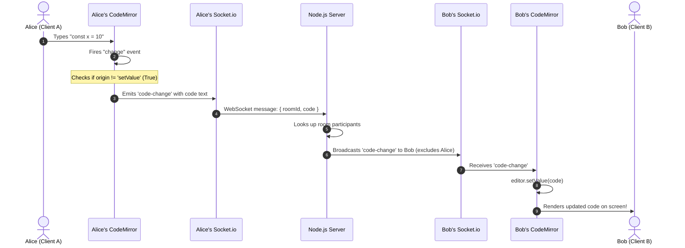

# 🔰 Beginner's Guide: Understanding Code Collab From Scratch

> **Target Audience:** Anyone who knows HTML, CSS, and basic React (components, JSX) and wants to understand how full-stack real-time web applications work. No prior backend or WebSocket experience assumed!

---

## Table of Contents
1. [The 10,000-Foot View: What Are We Building?](#1-the-10000-foot-view-what-are-we-building)
2. [The Core Problem: How Does the Internet Usually Work?](#2-the-core-problem-how-does-the-internet-usually-work)
3. [The Secret Weapon: WebSockets & Socket.IO](#3-the-secret-weapon-websockets--socketio)
4. [React Hooks Demystified for Beginners](#4-react-hooks-demystified-for-beginners)
5. [What is CodeMirror?](#5-what-is-codemirror)
6. [The Step-by-Step Life of a Single Keystroke](#6-the-step-by-step-life-of-a-single-keystroke)
7. [Glossary of Key Terms](#7-glossary-of-key-terms)

---

## 1. The 10,000-Foot View: What Are We Building?

Imagine **Google Docs**, but specifically designed for programmers to write code together.

- You open the website in your browser.
- You click **"New Room"** to get a unique Room ID (e.g., `4a5e381b-873b-48aa...`).
- You enter your name (e.g., "Alice") and click **JOIN**.
- You send that Room ID to your friend "Bob".
- Bob opens the website, enters the Room ID and his name, and clicks **JOIN**.
- **Now you both are in the same editor:**
  - Alice types `function helloWorld() { ... }` in New York.
  - Bob instantly sees those characters appear on his screen in London in real time without refreshing the browser!
  - Alice sees an avatar badge indicating "Bob" is in the room.
  - When Bob closes his tab, Alice receives a friendly notification: *"Bob left the room"*, and his avatar disappears.

---

## 2. The Core Problem: How Does the Internet Usually Work?

To appreciate why this project is special, you first need to know how regular websites work.

### The Traditional Web: HTTP Request & Response
Think of standard HTTP like **ordering food at a restaurant counter**:

```text
  [Browser / Client]                               [Server]
          |                                            |
          |  1. "Hey, please give me the home page"    |
          | -----------------------------------------> |
          |                                            |
          |  2. "Here is your HTML, CSS, and JS"       |
          | <----------------------------------------- |
          |                                            |
      [Connection Closes]                          [Waits...]
```

1. The client **asks** (Request).
2. The server **answers** (Response).
3. The connection is **closed**.

### Why HTTP Fails for Real-Time Collaboration
Imagine Bob types a new line of code on his laptop.
- The server now knows about Bob's new code.
- **Can the server tap Alice on the shoulder and say:** *"Hey Alice, Bob just wrote something, take this!"*?
- **NO!** With traditional HTTP, the server **cannot speak unless spoken to**. The server cannot push data to Alice unless Alice repeatedly asks: *"Did anything change? Did anything change? Did anything change?"* (This inefficient asking is called **HTTP Polling**).

---

## 3. The Secret Weapon: WebSockets & Socket.IO

### What is a WebSocket?
Instead of sending letters through the post office (HTTP), a **WebSocket is like an open phone call**.

```text
  [Alice's Browser]               [Node.js Server]                [Bob's Browser]
          |                              |                              |
          |==== Open 2-Way Connection ===|=== Open 2-Way Connection ====|
          |                              |                              |
          |  "Alice typed: 'let x = 5'"  |                              |
          | ---------------------------> |                              |
          |                              |  "Bob, Alice typed: ..."     |
          |                              | ---------------------------> |
```

- Both sides agree to keep a permanent connection open.
- Alice can send data to the server at any millisecond.
- The server can **instantly push** that data to Bob without Bob having to ask!

### What is Socket.IO?
Building raw WebSockets from scratch is difficult: you have to deal with broken WiFi connections, firewalls, reconnection logic, and room management.

**Socket.IO** is a popular JavaScript library that wraps WebSockets and provides:
1. **Rooms**: Grouping users together so Alice and Bob only share code with each other, not with unrelated users in another room.
2. **Auto-Reconnection**: If your internet blinks, Socket.IO automatically attempts to reconnect.
3. **Event-Based Communication**: You can name messages like `socket.emit('code-change', data)` and listen with `socket.on('code-change', callback)`.

---

## 4. React Hooks Demystified for Beginners

In basic React, you know:
- A **Component** is a JavaScript function that returns JSX (HTML-like syntax).
- **Props** are arguments passed down from parent components to child components.

In this project, two essential React Hooks do heavy lifting: `useRef` and `useEffect`. Let's understand why they exist.

### A. `useState` vs `useRef` (The Big Interview Question!)

#### `useState`:
When you update a state variable (`setRoomId('abc')`), React **re-renders** the component. The function runs again, re-calculating the HTML to show the new value on the screen.

#### `useRef`:
What if you want to store something in memory that **survives between renders**, but updating it **should NOT trigger a visual re-render**?
Think of `useRef` like a private locker or sticky note attached to your component:

```javascript
const socketRef = useRef(null);
```

- **Why don't we store the WebSocket in `useState`?**
  If we stored `socket` in `useState`, every time a socket event occurred or the state updated, the whole component might re-render, which could tear down the editor, cause cursor glitches, or re-establish duplicate socket connections.
- **Why do we store CodeMirror in `useRef`?**
  `editorRef.current = CodeMirror(...)` gives us direct access to the CodeMirror JavaScript instance (to call methods like `.setValue()` or `.getValue()`) without causing React re-renders.

### B. `useEffect` (Handling Side Effects)

React components are meant to calculate HTML. But sometimes a component needs to do things in the outside world:
- Connect to a WebSocket server.
- Initialize a third-party non-React library (like CodeMirror).
- Set up event listeners.

That is what `useEffect` is for:

```javascript
useEffect(() => {
  // 1. Code here runs once when the component is placed on screen (mount)
  const socket = initSocket();

  return () => {
    // 2. Code here runs when the component is removed from screen (unmount)
    socket.disconnect(); // Clean up so we don't leave zombie connections!
  };
}, []); // Empty array [] means: "Only run on first load, never on re-render"
```

---

## 5. What is CodeMirror?

HTML only has `<textarea>`, which is just a boring plain text box. It has no line numbers, no syntax coloring, no auto-closing brackets, and no code indentation.

**CodeMirror** is an open-source browser code editor written in JavaScript (used by tools like CodePen).

In our project:
1. We put a plain `<textarea id="realTimeEditor"></textarea>` in the HTML.
2. Inside `useEffect`, we tell CodeMirror:
   ```javascript
   const editor = CodeMirror.fromTextArea(document.getElementById('realTimeEditor'), {
       mode: { name: 'javascript', json: true }, // syntax highlighting
       theme: 'dracula',                         // cool dark theme
       autoCloseBrackets: true,                  // typing '(' adds ')'
       lineNumbers: true,                        // shows 1, 2, 3...
   });
   ```
3. CodeMirror replaces the boring `<textarea>` with an interactive, rich code editor!

---

## 6. The Step-by-Step Life of a Single Keystroke

Let's trace exactly what happens when User A types the letter `"const"`:



1. **User Action:** Alice types in her editor.
2. **CodeMirror Detects It:** CodeMirror has an `editor.on('change', ...)` listener.
3. **Loop Prevention Check:** CodeMirror checks: *"Did a human type this, or was this generated by our own code?"* (`origin !== 'setValue'`). Since Alice typed it, it proceeds.
4. **Emit to Server:** Alice's client sends a WebSocket event named `'code-change'` containing the current room ID and full code.
5. **Server Relays Message:** The Node.js server receives `'code-change'` and sends it to everyone in that room **except** Alice:
   ```javascript
   socket.in(roomId).emit('code-change', { code });
   ```
6. **Bob Receives It:** Bob's browser hears `'code-change'`.
7. **Editor Updates:** Bob's CodeMirror calls `editor.setValue(code)`. Bob sees the text update instantly!

---

## 7. Glossary of Key Terms

| Term | Simple Definition |
| :--- | :--- |
| **Client** | The frontend application running in the user's browser (React + Vite). |
| **Server** | The backend application running in the cloud or terminal (Node.js + Express). |
| **Socket ID** | A unique random string assigned to each connected browser tab by Socket.IO (e.g. `s7F_89xa...`). |
| **Room ID** | A unique UUID representing a shared virtual room. Multiple socket IDs can join one room ID. |
| **Emit** | Sending an event/message with data across the WebSocket connection. |
| **Listener (`.on`)**| Waiting for a specific event name to arrive and executing a callback function. |
| **Broadcast** | Sending a message to multiple connected clients at once. |
| **Mount / Unmount**| When a React component appears on the screen (mount) vs when it disappears (unmount). |
| **Clean-up Function**| The function returned by `useEffect` that tears down sockets, timers, or event listeners when the user leaves. |

---

### Next Step
Now that you have the mental model, read **[02-SYSTEM-ARCHITECTURE.md](./02-SYSTEM-ARCHITECTURE.md)** to see the technical mechanics and flowcharts.

