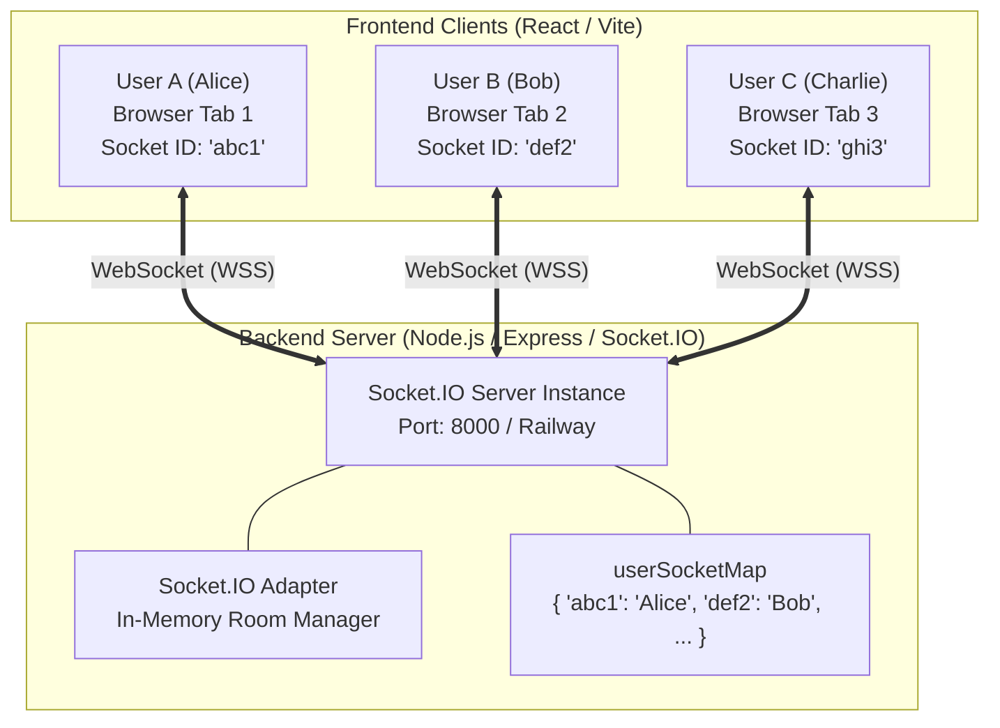
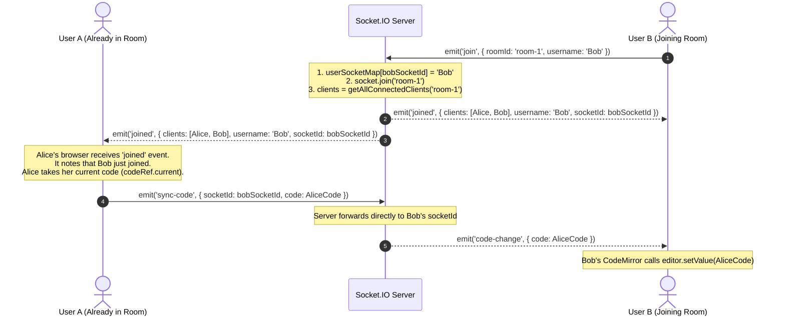
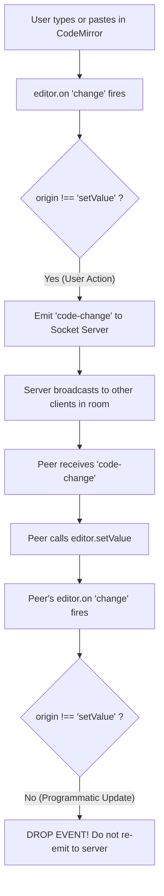
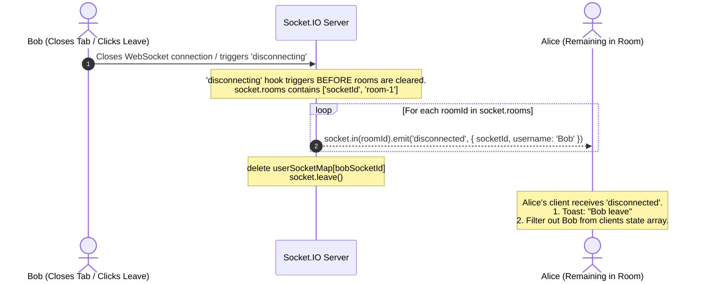

# 🏛️ System Architecture Deep Dive: Code Collab

This document details the architectural design, data structures, network communication protocols, and edge-case handling powering **Code Collab**.

---

## 1. System Architecture Overview

Code Collab follows a **Client-Server Event-Driven Architecture** utilizing persistent, full-duplex WebSocket connections.



### Components
1. **Frontend (Client)**:
   - Built with **React 19** and bundled with **Vite**.
   - Handles the editor UI (`CodeMirror`), user avatar list (`react-avatar`), routing (`react-router-dom`), and WebSocket messaging (`socket.io-client`).
2. **Backend (Server)**:
   - Built with **Node.js** and **Express 5**, using `http.createServer` combined with `socket.io`.
   - Manages active rooms, tracks user identities in an in-memory map, and relays code changes and presence events.
3. **Transport Layer**:
   - WebSocket protocol (`ws://` locally or `wss://` over TLS in production).
   - Upgraded from HTTP during the initial Socket.IO handshake.

---

## 2. Server-Side Data Structures & State Management

The backend maintains state entirely in-memory (no database required for ephemeral sessions):

### 1. `userSocketMap`
A plain JavaScript object mapping individual socket connections to usernames:
```javascript
const userSocketMap = {}; 
// Example structure:
// {
//   "s8xK_9dLaQ": "Alice",
//   "m351m5g89w": "Bob"
// }
```

### 2. `io.sockets.adapter.rooms`
An internal `Map` maintained natively by Socket.IO.
- **Key**: `roomId` (string)
- **Value**: `Set<socketId>` containing all socket IDs currently joined to that room.

### 3. Helper: `getAllConnectedClients(roomId)`
Calculates the list of active users in a specific room by cross-referencing Socket.IO's room set with `userSocketMap`:
```javascript
const getAllConnectedClients = (roomId) => {
  return Array.from(io.sockets.adapter.rooms.get(roomId) || []).map(
    (socketId) => ({
      socketId,
      username: userSocketMap[socketId],
    })
  );
};
```

---

## 3. The WebSocket Event Lifecycle

Every interaction in Code Collab is an asynchronous event. Here is the formal specification:

| Event Name | Emitter | Recipient | Payload | Purpose |
| :--- | :--- | :--- | :--- | :--- |
| `join` | Client | Server | `{ roomId, username }` | Client requests to join a room. |
| `joined` | Server | All Clients in Room | `{ clients, username, socketId }` | Server notifies room members of new joiner; sends updated user list. |
| `sync-code` | Existing Client | Server | `{ socketId, code }` | Existing peer sends current code specifically for the new joiner. |
| `code-change` | Client / Server | Server / Room | `{ roomId, code }` or `{ code }` | Broadcasts new editor contents to all other room members. |
| `disconnecting`| Socket Engine | Server (Internal) | *None* | Triggered right before the socket leaves its rooms on tab close/nav. |
| `disconnected` | Server | All Clients in Room | `{ socketId, username }` | Notifies remaining room members that a user left. |

---

## 4. Detailed Sequence Workflows

### Workflow A: User Joining a Room & Initial State Sync
When User B joins an existing room occupied by User A, User B must receive:
1. The list of active participants.
2. The code that User A has already typed.



> **Why peer-to-peer code sync?**
> The server does not store the document in a database or in server RAM. Instead, existing clients act as authoritative peers who sync the latest document state to the newcomer.

---

### Workflow B: Real-Time Typing & The Infinite Loop Prevention

When User A types, their editor triggers an `onChange` event. If User B receives that change and calls `editor.setValue(code)`, User B's editor will *also* fire an `onChange` event!

If unhandled, this results in an **Infinite Echo Loop**:
`User A types -> sends to Server -> sends to User B -> User B fires change -> sends to Server -> sends to User A -> User A fires change... (Crash!)`

#### The Solution: CodeMirror Change Origin Inspection



In CodeMirror, when you call `editor.setValue(code)`, the change object contains `origin: 'setValue'`. By checking:
```javascript
if (origin !== 'setValue') {
  socketRef.current.emit('code-change', { roomId, code });
}
```
we immediately drop programmatic updates and break the infinite loop!

---

### Workflow C: Clean Disconnection & Presence Update

When a user closes their tab, refreshes, or clicks "Leave Room":



---

## 5. Architectural Trade-offs & Analysis

Every architectural decision comes with advantages and compromises:

### 1. In-Memory State vs. Database Persistence
- **Choice**: Store `userSocketMap` in Node.js server memory and sync code peer-to-peer.
- **Advantage**: Lightning-fast performance (zero disk I/O, zero database latency), simple zero-dependency deployment.
- **Compromise**: If all users leave a room, the code is lost (ephemeral sessions). If the server restarts or crashes, existing sessions disconnect.

### 2. Full-Document Sync vs. Operational Transformation (OT) / CRDTs
- **Choice**: Sending the entire code string (`code`) on edit.
- **Advantage**: Simple to reason about, low code complexity, works great for small-to-medium teams pair-programming together.
- **Compromise**: For massive documents (100k lines) or rapid simultaneous typing at the exact same millisecond, full string replacement can cause cursor jumps or race conditions. (In production systems like Google Docs, OT or CRDTs like Yjs/Automerge are used).

### 3. Client-Side Authoritative Sync
- **Choice**: When a new user joins, the existing peer in the room sends the code via `sync-code`.
- **Advantage**: Server doesn't need to parse, tokenize, or cache document states.
- **Compromise**: If User A's browser has slow internet or tab throttling when User B joins, User B might experience a slight delay in receiving the code.

---

### Next Step
Read **[03-CODE-WALKTHROUGH.md](./03-CODE-WALKTHROUGH.md)** for a line-by-line breakdown of every file in the repository.

