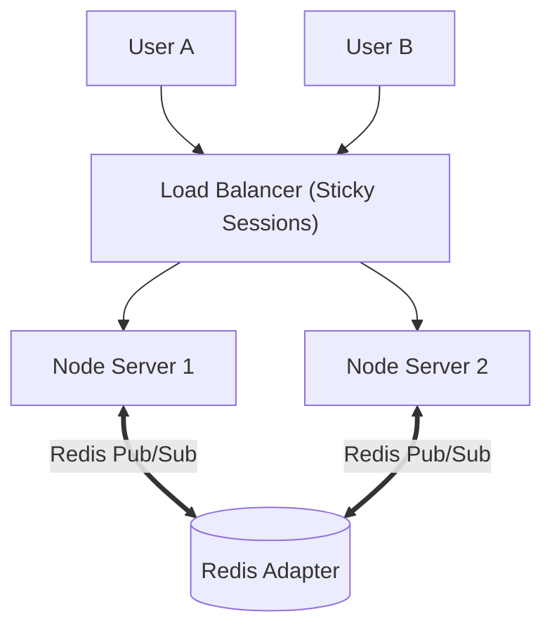

# 🎯 The Technical Interview Masterclass: Code Collab

This document contains real-world interview questions, structured answers, system design discussions, and talk tracks tailored to **Code Collab**.

---

## Table of Contents
1. [Section 1: The Elevator Pitch (How to Introduce the Project)](#section-1-the-elevator-pitch-how-to-introduce-the-project)
2. [Section 2: Networking & WebSockets Deep Dive](#section-2-networking--websockets-deep-dive)
3. [Section 3: Core Architecture & Edge Cases](#section-3-core-architecture--edge-cases)
4. [Section 4: React & Frontend Challenges](#section-4-react--frontend-challenges)
5. [Section 5: Concurrency, OT, and CRDTs (The Senior Question!)](#section-5-concurrency-ot-and-crdts-the-senior-question)
6. [Section 6: Scalability & System Design](#section-6-scalability--system-design)
7. [Section 7: Future Improvements & Version 1.1 Roadmap](#section-7-future-improvements--version-11-roadmap)

---

## Section 1: The Elevator Pitch (How to Introduce the Project)

### Q: "Tell me about this project on your resume."

#### 🎙️ 30-Second Version (Quick & Punchy):
> *"Code Collab is a real-time collaborative code editor that allows multiple developers to code together simultaneously in shared virtual rooms, similar to Google Docs. I built the frontend with React and CodeMirror, and the backend with Node.js, Express, and Socket.IO. It features real-time code synchronization, live presence avatars, automatic state catch-up for new joiners, and instant clipboard sharing."*

#### 🎙️ 90-Second Version (Technical & Structured - STAR Method):
> - **Situation & Task:** *"I wanted to understand how distributed real-time applications handle bi-directional data flow and state synchronization without page refreshes. I decided to build Code Collab, a multi-user collaborative code editor."*
> - **Action:** *"On the frontend, I used React with Vite and integrated CodeMirror for syntax highlighting and editor state. For real-time communication, I established persistent full-duplex WebSocket connections using Socket.IO. On the backend, I implemented a Node.js and Express server that leverages Socket.IO rooms to isolate collaboration sessions. I solved critical edge cases like the infinite echo loop—where broadcasting a change can recursively trigger updates across clients—by filtering editor change origins. I also implemented a peer-assisted sync mechanism so late joiners immediately inherit the existing room's code state."*
> - **Result:** *"The application enables seamless peer-to-peer style collaboration with sub-100ms latency, zero database overhead for ephemeral sessions, and was deployed to production with a responsive dark-mode UI."*

---

## Section 2: Networking & WebSockets Deep Dive

### Q1: Why did you choose WebSockets over traditional HTTP or polling?
**Answer:**
> *"Traditional HTTP follows a unidirectional Request-Response model where only the client can initiate a conversation. In a collaborative editor, if User A types code, the server needs to instantly push that code to User B.
> 
> With HTTP, User B would have to constantly ask the server every 500ms ('Did anything change?'), known as **short polling**. This creates massive network overhead, wasted bandwidth with empty HTTP headers, and noticeable latency.
> 
> **WebSockets**, by contrast, maintain a persistent, bidirectional TCP connection. Once the initial handshake completes, both client and server can send lightweight frames back and forth in milliseconds with minimal protocol overhead."*

---

### Q2: What is the difference between WebSockets and Server-Sent Events (SSE)?
**Answer:**
> *"Server-Sent Events (SSE) provide a **unidirectional** stream from server to client over HTTP. While SSE is great for live sports tickers or stock feeds where only the server emits updates, collaborative editing requires **bidirectional** communication (both clients sending keystrokes and receiving peer updates). WebSockets are naturally suited for full-duplex two-way interaction."*

---

### Q3: Why use Socket.IO instead of the native browser WebSocket API?
**Answer:**
> *"Native WebSockets provide a low-level byte/string stream, but lack higher-level application abstractions. I chose Socket.IO because:
> 1. **Rooms & Namespaces**: Socket.IO has built-in support for rooms (`socket.join(roomId)` and `socket.to(roomId)`), allowing us to isolate rooms without writing custom multiplexing logic.
> 2. **Automatic Reconnection**: If a user switches WiFi or their connection drops, Socket.IO automatically buffers events and reconnects.
> 3. **Named Event Architecture**: Instead of parsing raw JSON strings with `JSON.parse(event.data)` inside a single `onmessage` switch-statement, Socket.IO allows clean event-driven code like `socket.on('code-change')` and `socket.on('joined')`."*

---

### Q4: Explain the difference between `socket.emit`, `socket.broadcast.emit`, and `io.to().emit`.
**Answer:**
| Method | Who Receives It? | Used in Project? |
| :--- | :--- | :--- |
| `socket.emit('event', data)` | Only the sender socket. | Yes (sending `join` to server). |
| `socket.broadcast.emit('event', data)` | Everyone connected to the server **except** the sender. | No (it ignores rooms). |
| `socket.in(roomId).emit('event', data)` | Everyone in that specific room **except** the sender. | **Yes** (`code-change`, `disconnected`). |
| `io.to(socketId).emit('event', data)` | Specifically targeted to one single socket ID. | **Yes** (`sync-code` to late joiner). |
| `io.to(roomId).emit('event', data)` | Everyone in that room **including** the sender. | Yes (when broadcasting updated client list). |

---

## Section 3: Core Architecture & Edge Cases

### Q5: What is the "Infinite Echo Loop" problem, and how did you solve it?
**Answer:**
> *"This is one of the most critical challenges in real-time editors:
> 1. User A types a letter `x`. This triggers CodeMirror's `onChange` event on User A's browser.
> 2. User A's client emits `code-change` to the server, which forwards it to User B.
> 3. User B receives the new code and calls `editor.setValue(code)`.
> 4. Calling `editor.setValue()` programmatically **also triggers** CodeMirror's `onChange` event on User B!
> 5. If User B's client blindly emits this back to the server, the server sends it back to User A, creating an infinite feedback loop that freezes the browser and crashes the server.
> 
> **How I solved it:**
> CodeMirror passes a `changes` object to its change handler with an `origin` property. When a human types or pastes, `origin` is `'+input'` or `'+delete'`. When updated programmatically via code, `origin` is `'setValue'`.
> In my `Editor.jsx`, I added:
> ```javascript
> if (origin !== 'setValue') {
>   socketRef.current.emit('code-change', { roomId, code });
> }
> ```
> This breaks the cycle because programmatic updates are never broadcast back."*

---

### Q6: How does a user who joins 10 minutes late get the current code?
**Answer:**
> *"Since we do not store active document drafts in a database, I implemented a **Peer-Assisted Synchronization** strategy:
> 1. When New User (Bob) joins room `123`, the server emits a `'joined'` event containing Bob's `socketId` to all room members.
> 2. An existing peer in the room (Alice) receives the `'joined'` event.
> 3. Alice's client immediately grabs her latest editor code from `codeRef.current` and emits a `'sync-code'` event targeting Bob's specific `socketId`.
> 4. The server receives this and routes the code directly to Bob via `io.to(socketId).emit('code-change', { code })`.
> 5. Bob's editor receives the payload and sets the initial code state."*

---

### Q7: Why did you use `disconnecting` instead of `disconnect` on the server?
**Answer:**
> *"In Socket.IO, when a client closes their tab or loses internet:
> - The `disconnecting` event fires **while the socket is still in all its rooms**. This allows us to inspect `socket.rooms` and broadcast a `'disconnected'` event with the username to all peers in those rooms.
> - By the time the `disconnect` event fires, Socket.IO has already removed the socket from all rooms, so `socket.rooms` is empty, making it impossible to know which rooms needed to be notified."*

---

## Section 4: React & Frontend Challenges

### Q8: Why use `useRef` for `socketRef`, `editorRef`, and `codeRef` instead of `useState`?
**Answer:**
> *"There are two main reasons:
> 1. **Avoiding Unnecessary Re-renders:** In React, updating a `useState` variable schedules a component re-render. If we stored the CodeMirror instance or WebSocket instance in state, re-renders could disrupt the DOM, reset cursor positions, or cause socket re-connections.
> 2. **Avoiding Stale Closures in Event Listeners:** In `EditorPage.jsx`, when the socket receives a `'joined'` event, it needs to access the latest code to sync with the new joiner. If we used state, the event listener registered in `useEffect` on mount would capture a 'stale' snapshot of the initial state. Storing the latest code inside `codeRef.current` ensures that our socket callbacks always access the current value by reference."*

---

### Q9: How did you integrate CodeMirror (a non-React imperative library) into a declarative React app?
**Answer:**
> *"CodeMirror 5 directly manipulates the browser DOM. To integrate it cleanly into React:
> 1. I rendered an unstyled `<textarea id="realTimeEditor"></textarea>` in JSX.
> 2. Inside a `useEffect` hook with an empty dependency array `[]`, I called `CodeMirror.fromTextArea()`. This mounts CodeMirror once when the component enters the DOM.
> 3. I stored the resulting editor instance in `editorRef.current` so React can interact with it imperatively (calling `.getValue()` and `.setValue()`).
> 4. In the cleanup function of `useEffect`, we safely detach listeners to prevent memory leaks."*

---

### Q10: How does route protection work when joining an editor room?
**Answer:**
> *"When a user joins from the Home page, we navigate using:
> ```javascript
> navigate(`/editor/${roomId}`, { state: { username } });
> ```
> In `EditorPage.jsx`, we read `const location = useLocation()`. If someone tries to bypass the Home page by bookmarking or directly typing `http://localhost:5173/editor/abc-123`, `location.state` will be `null`.
> 
> We check:
> ```javascript
> if (!location.state) return <Navigate to="/" />;
> ```
> This immediately redirects unauthenticated users back to the landing page to enter their username."*

---

## Section 5: Concurrency, OT, and CRDTs (The Senior Question!)

### Q11: What happens if two users type at the exact same millisecond? How does your project handle it, and how does Google Docs handle it?
**Answer:**
> *"In our current implementation, we broadcast the full document string (`code`). If two users type simultaneously at different parts of the document, the last message received by the server wins (Last-Write-Wins), which can overwrite the other user's character.
> 
> For a production enterprise system like Google Docs or Figma, you don't broadcast the whole string; you broadcast **operations** (insert character 'a' at position 12).
> 
> There are two proven algorithmic solutions for this:
> 1. **Operational Transformation (OT):**
>    - Used by Google Docs and Apache Wave.
>    - A central server acts as the authority. When two concurrent operations arrive, the server transforms the operations based on index offsets (e.g. if User A inserted 5 characters before User B's cursor, User B's insertion index is shifted +5).
> 2. **Conflict-Free Replicated Data Types (CRDTs):**
>    - Used by modern collaborative tools like Apple Notes, Figma, and Zed.
>    - Each character has a globally unique, mathematically ordered ID. Edits can be merged in any order on any peer without needing a central server, guaranteeing eventual consistency. Libraries like **Yjs** or **Automerge** implement this.
> 
> In a future iteration of Code Collab, I would integrate **Yjs with CodeMirror** to achieve character-level conflict-free concurrent editing."*

---

## Section 6: Scalability & System Design

### Q12: If traffic grows and you need 5 backend server instances behind a Load Balancer, what breaks and how do you fix it?
**Answer:**
> *"Two major things break:
> 1. **The WebSocket Handshake:** WebSocket upgrades start with HTTP. If the HTTP handshake hits Server 1, but the subsequent WebSocket frame hits Server 2, the connection will fail.
>    - **Fix:** Enable **Sticky Sessions (Session Affinity)** on the load balancer (e.g., NGINX, AWS ALB) using cookies, ensuring a client always connects to the same server node.
> 2. **Cross-Server Room Communication:** If Alice is connected to Server 1 and Bob is in the same room on Server 2, Server 1 has no way to emit an event to Bob!
>    - **Fix:** Use the **Socket.IO Redis Adapter (`@socket.io/redis-adapter`)**. When Server 1 emits to `roomId`, the event is published to a Redis Pub/Sub channel. All 5 servers subscribe to Redis and broadcast the message to their local connected clients."*



---

### Q13: How would you add persistence so the code isn't lost when everyone leaves?
**Answer:**
> *"1. Add a MongoDB or PostgreSQL database.
> 2. Create a `Room` model:
>    ```typescript
>    {
>      roomId: String,
>      title: String,
>      code: String,
>      language: String,
>      updatedAt: Date
>    }
>    ```
> 3. Instead of writing to the database on every single keystroke (which would overload the DB with 50 writes/second), implement a **Debounced Auto-Save** mechanism:
>    - Buffer code changes in server memory.
>    - Every 3–5 seconds after user activity pauses, commit the current draft to the database.
> 4. When a user creates or joins a room for the first time, load the initial code directly from the DB."*

---

## Section 7: Future Improvements & Version 1.1 Roadmap

When an interviewer asks: *"If you had another 2 weeks, what would you add or improve?"*, refer to this roadmap:

1. **Multi-Language Execution Engine:**
   - Integrate with the **Judge0 API** or **Piston API** to compile and execute code in 40+ languages (Python, C++, Java, JavaScript) directly from the browser and display stdout/stderr in a console tab.
2. **Collaborative Remote Cursors:**
   - Use CodeMirror's `setBookmark` and Socket.io to broadcast cursor coordinates `{ line, ch }` so users can see each other's colored cursor flags with their name tag.
3. **In-Room Group Chat:**
   - Add a collapsible chat sidebar using a new Socket.IO event `chat-message` so collaborators can discuss code without opening external apps.
4. **Export & Download:**
   - Add a button to download the current buffer as a `.js`, `.py`, or `.cpp` file using the HTML5 `Blob` and `URL.createObjectURL()` API.

---

### Summary Checklist for Interview Day
- [ ] Memorized the 30-second and 90-second pitches.
- [ ] Can clearly explain the "Infinite Echo Loop" and `origin !== 'setValue'`.
- [ ] Understand why `useRef` was used instead of `useState` for sockets and CodeMirror.
- [ ] Can explain how late joiners get code via peer-sync (`joined` -> `sync-code`).
- [ ] Can discuss Redis Adapter and CRDTs / OT when asked about scaling.

