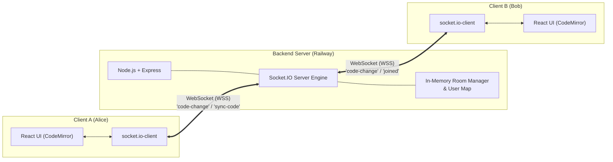

# 💻 Code Collab — Real-Time Collaborative Code Editor

A full-stack, real-time multi-user code collaboration platform where developers can create or join shared rooms, write code simultaneously with instant synchronization, view connected participants' avatars, and collaborate seamlessly.

[](https://code-collab.tech/)
[](https://react.dev/)
[](https://socket.io/)
[](https://railway.app/)

---

## 📚 Interview Preparation & Architecture Documentation

To help you understand the system architecture from scratch and master technical interviews, the documentation has been organized into specialized guides:

| Document | Description |
| :--- | :--- |
| **[🔰 01. Beginner's Guide](docs/01-BEGINNER-GUIDE.md)** | Start here! Explains WebSockets vs HTTP, React hooks (`useRef`, `useEffect`), CodeMirror, and the lifecycle of a keystroke in simple language. |
| **[🏛️ 02. System Architecture](docs/02-SYSTEM-ARCHITECTURE.md)** | Detailed network flows, event lifecycle diagrams, the Infinite Echo Loop solution, and late-joiner state synchronization. |
| **[🔍 03. Line-by-Line Code Walkthrough](docs/03-CODE-WALKTHROUGH.md)** | Deep code inspection of `server/index.js`, `EditorPage.jsx`, `Editor.jsx`, `Home.jsx`, and `socket.jsx`. |
| **[🎯 04. Technical Interview Masterclass](docs/04-INTERVIEW-QA.md)** | 30-sec/90-sec project pitches, 15+ high-probability interview questions & answers, Operational Transformation (OT) vs CRDTs, and horizontal scaling with Redis. |

---

## ✨ Features

- **⚡ Real-Time Bi-Directional Synchronization:** Changes typed by one user reflect instantly across all connected peers with low latency over WebSockets.
- **🚪 Dynamic Room Creation & Joining:** Generate secure, collision-free UUID room IDs or join existing rooms with custom usernames.
- **👥 Live User Presence & Avatars:** See deterministic colorful avatar badges for all active collaborators in the room.
- **🔔 Instant Notifications:** Non-intrusive toast alerts when users join or leave the room (`react-hot-toast`).
- **🔄 Late-Joiner State Sync:** New users joining an ongoing session automatically receive the latest code without needing a persistent database.
- **📋 One-Click Room ID Copy:** Copy the Room ID to the system clipboard via the browser Clipboard API.
- **🎨 Dracula Theme Code Editor:** Syntax highlighting, line numbers, and auto-closing brackets/tags powered by CodeMirror.
- **🛡️ Route Protection:** Redirects direct URL access back to the home page if a user has not entered a username.

---

## 🏗️ High-Level System Architecture



---

## 🛠️ Tech Stack

### Frontend
- **Framework:** React 19 (Functional components, Hooks)
- **Build Tool:** Vite 6
- **Code Editor:** CodeMirror 5 (JavaScript mode, Dracula theme, auto-close addons)
- **Real-Time Client:** Socket.IO Client 4
- **Routing:** React Router v7 (`BrowserRouter`, `useNavigate`, `useLocation`, `useParams`)
- **Styling:** Bootstrap 5
- **UI Utilities:** `react-hot-toast` (notifications), `react-avatar` (avatars), `uuid` (UUIDv4 room generation)

### Backend
- **Runtime:** Node.js
- **Server Framework:** Express 5
- **Real-Time Protocol:** Socket.IO 4 (WebSockets with HTTP fallback)
- **Development Tool:** Nodemon

---

## 📁 Project Directory Structure

```text
code-collab/
├── client/                     # Frontend React Application
│   ├── index.html              # HTML entry point (dark theme)
│   ├── package.json            # Frontend dependencies & scripts
│   ├── vite.config.js          # Vite configuration
│   └── src/
│       ├── main.jsx            # React root & BrowserRouter setup
│       ├── App.jsx             # Top-level routing & Toast provider
│       ├── socket.jsx          # Socket.IO client initialization
│       ├── components/
│       │   ├── Home.jsx        # Landing page (create/join room)
│       │   ├── EditorPage.jsx  # Main workspace layout & user presence
│       │   ├── Editor.jsx      # CodeMirror integration & sync logic
│       │   └── Client.jsx      # Avatar item component for participants
│       └── ...
├── server/                     # Backend Node.js Application
│   ├── package.json            # Server dependencies & scripts
│   └── index.js                # Express & Socket.IO server implementation
├── docs/                       # Comprehensive Interview & Architecture Guides
│   ├── 01-BEGINNER-GUIDE.md    # ELI5 guide to WebSockets & React hooks
│   ├── 02-SYSTEM-ARCHITECTURE.md# Detailed sequence diagrams & event flows
│   ├── 03-CODE-WALKTHROUGH.md  # Line-by-line codebase analysis
│   └── 04-INTERVIEW-QA.md      # Interview pitches, Q&A, and system design
└── readme.md                   # Project overview & quickstart
```

---

## 🚀 Quickstart Guide (Run Locally)

Follow these steps to run the complete project locally on your machine.

### Prerequisites
- [Node.js](https://nodejs.org/) (v18 or higher recommended)
- `npm` (bundled with Node.js)

---

### Step 1: Start the Backend Server

```bash
# Navigate to the server folder
cd server

# Install dependencies
npm install

# Start the server with hot reload
npm start
```
The server will start on `http://localhost:8000`. You will see:
```text
server is running
```

---

### Step 2: Configure & Start the Client

Open a **new terminal tab or window**:

```bash
# Navigate to the client folder
cd client

# Install dependencies
npm install
```

> **Note for Local Testing:**
> In `client/src/socket.jsx`, ensure the socket connection points to your local server:
> ```javascript
> return io('http://localhost:8000', option);
> ```
> *(In production, this points to your deployed backend URL on Railway).*

Now start the development server:
```bash
npm run dev
```

Open `http://localhost:5173` in two different browser tabs (or an Incognito window) to test real-time collaboration with yourself!

---

## 💡 How It Works Under the Hood

1. **Creating a Room:**
   Clicking **"New Room"** generates a RFC4122 UUID v4 (`uuid()`) and populates the Room ID input field.
2. **Joining a Room:**
   Entering a username and room ID navigates to `/editor/:roomId`, passing the username via React Router navigation state.
3. **Establishing the Socket:**
   `EditorPage` mounts and executes `initSocket()`. It sends a `join` event with `{ roomId, username }`.
4. **Room Broadcast:**
   The server attaches the client to the room (`socket.join(roomId)`) and notifies all occupants via the `joined` event.
5. **Code Synchronization:**
   Existing users in the room detect the new joiner and emit `sync-code` to push the current code buffer directly to the newcomer's socket ID.
6. **Editing:**
   As you type, CodeMirror fires an `onChange` event. If the change was initiated by human typing (`origin !== 'setValue'`), the updated buffer is emitted via `code-change` to all room peers.
7. **Clean Disconnect:**
   When a user navigates away or closes their tab, the server's `disconnecting` listener fires, cleans up `userSocketMap`, and announces `disconnected` to remaining room members.

---

## 🗺️ Roadmap & Upcoming Features (Version 1.1)

- [x] Room creation & joining via unique Room IDs
- [x] Real-time bi-directional code synchronization
- [x] Dracula theme styling & user avatars
- [x] Late-joiner peer code synchronization
- [ ] **Multi-Language Support:** Dropdown for Python, C++, Java, and JavaScript syntax highlighting
- [ ] **Code Execution Engine:** Run programs in the cloud using Judge0 or Piston API and display console outputs
- [ ] **Collaborative Remote Cursors:** Visual cursor markers with collaborator names
- [ ] **In-Room Group Chat:** Real-time text chat alongside the editor
- [ ] **Export / Download:** Download the code file directly as `.js`, `.py`, etc.

---

## 📄 License
This project is open-source and available under the [ISC License](server/package.json).
